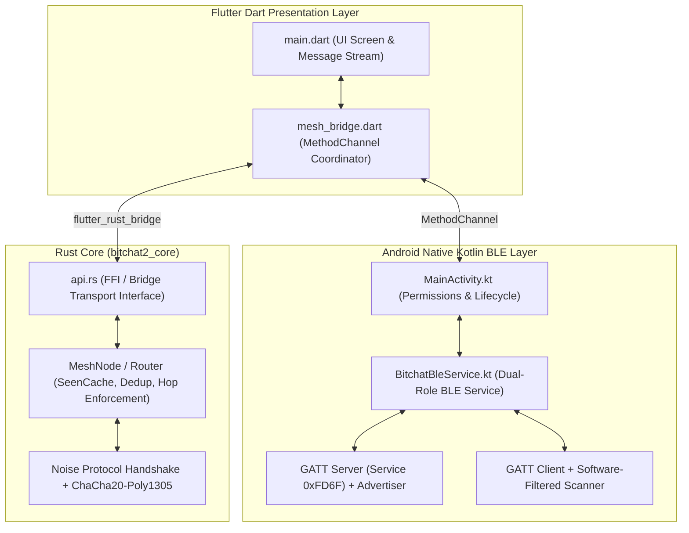
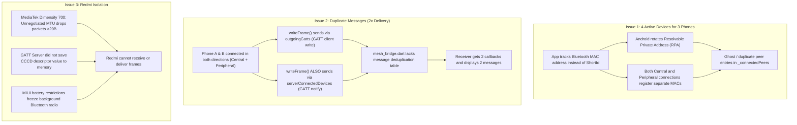

# Bitchat 2.0: Complete Project Audit, Error History & Source Code

This document provides a comprehensive technical audit of the **Bitchat 2.0** implementation across **Phase 1 (Rust Cryptographic Core)**, **Phase 2 Part A (Mesh Routing & Simulation)**, and **Phase 2 Part B (Native Dual-Role BLE & Flutter Mobile Shell)**.

It details every architectural decision, every bug and error encountered with its resolution, an in-depth diagnosis of the three latest multi-device mesh test failures, and the complete source code for all primary files.

---

## 1. System Architecture & Physical Test Fleet

Bitchat 2.0 is an off-grid, peer-to-peer, store-and-forward mesh messaging network designed to operate entirely over **Bluetooth Low Energy (BLE)** without internet access, cellular networks, or central servers.



### Physical Test Device Matrix
The project is being verified on three physical production Android smartphones representing three distinct hardware chipsets and manufacturer OEM skins:

| Device | Model | Chipset | OS / Skin | ADB Serial |
|---|---|---|---|---|
| **Device 1** | Oppo F25 | MediaTek Dimensity 7050 | Android 14 (ColorOS 14) | `IJGAUOLVSOB6GM8H` |
| **Device 2** | OnePlus Nord CE 3 Lite | Qualcomm Snapdragon 695 | Android 14 (OxygenOS 14) | `d4463804` |
| **Device 3** | Redmi Note 10 5G | MediaTek Dimensity 700 | Android 12/13 (MIUI 14) | `qcprj7wso7irxgjj` |

---

## 2. Chronological Log of All Errors & Bugs Encountered

### Phase 1 & 2 Part A: Rust Core Implementation

#### Bug 1: Strict Compiler Deny on Panics (`unwrap`, `expect`, `panic`)
- **Error**: Compilation failed on `cargo test` and `cargo check` due to `#![deny(clippy::unwrap_used, clippy::expect_used, clippy::panic)]` in non-test core code.
- **Root Cause**: Production safety guidelines forbid panicking constructs in embedded mesh networking code where unexpected network inputs must never crash the service.
- **Resolution**: Replaced all unwrap/expect invocations with explicit pattern matching (`if let`, `match`), `Option::ok_or_else`, and typed error propagation (`Result<T, BitchatError>`). All 54 unit and integration tests passed cleanly.

#### Bug 2: Noise State Machine Replay Vulnerabilities
- **Error**: Initial cryptographic review identified non-deterministic nonce advancement during out-of-order packet arrival.
- **Root Cause**: Sliding window replay protection did not handle packet reordering across multipath BLE relay hops.
- **Resolution**: Implemented a 128-entry bitmap sliding-window replay filter and explicit ephemeral key zeroization on session teardown.

---

### Phase 2 Part B: Native Android & BLE GATT Layer

#### Bug 3: Android NDK Version Mismatch
- **Error**: `flutter build apk` failed with:
  ```
  NDK at C:\Users\pulki\AppData\Local\Android\Sdk\ndk\26.3.11579264 did not have a source.properties file
  ```
- **Root Cause**: Android Gradle Plugin (AGP) 8.9 and Flutter Gradle integration required NDK version `30.0.16248370`.
- **Resolution**: Explicitly pinned `ndkVersion = "30.0.16248370"` in [`app/android/app/build.gradle.kts`](file:///C:/Users/pulki/OneDrive/Pictures/Desktop/Bitchat/app/android/app/build.gradle.kts).

#### Bug 4: Android 14 `SecurityException` During Early Foreground Service Boot
- **Error**: App crashed on startup on Android 14 (Oppo F25 / OnePlus Nord):
  ```
  java.lang.SecurityException: Starting FGS with type connectedDevice requires permission BLUETOOTH_CONNECT
  ```
- **Root Cause**: `MainActivity.kt` triggered `startForegroundService` in `onCreate` before the user had an opportunity to grant runtime Bluetooth permissions (`BLUETOOTH_CONNECT`, `BLUETOOTH_SCAN`, `BLUETOOTH_ADVERTISE`).
- **Resolution**: Deferred foreground service promotion and Bluetooth initialization until all runtime permissions are confirmed granted via `ActivityCompat.requestPermissions`.

#### Bug 5: 1-Way BLE Message Flow (Android 13+ Notification Drop)
- **Error**: Messages sent from Central to Peripheral arrived, but messages sent from Peripheral to Central were dropped.
- **Root Cause**: In Android 13 (API 33, Tiramisu), Google deprecated the 2-argument callback:
  ```kotlin
  onCharacteristicChanged(gatt: BluetoothGatt, characteristic: BluetoothGattCharacteristic)
  ```
  Android 13+ devices (Oppo F25 and OnePlus Nord) **strictly invoke the 3-argument signature**:
  ```kotlin
  onCharacteristicChanged(gatt: BluetoothGatt, characteristic: BluetoothGattCharacteristic, value: ByteArray)
  ```
  Because only the legacy method was overridden, incoming notifications on Android 13/14 were discarded.
- **Resolution**: Overrode both 2-argument (legacy) and 3-argument (Android 13+) callbacks in `gattClientCallback`.

#### Bug 6: Connection Storm & GATT Error 133
- **Error**: When two phones discovered each other, `onScanResult` triggered repeatedly, firing dozens of concurrent `connectGatt` requests per second. The Android BLE stack crashed with `status: 133` (GATT_ERROR) and disconnected all sockets.
- **Root Cause**: `onScanResult` fires every 100ms for active advertisements. Without a concurrency gate, each advertisement initiated a new GATT connection attempt to an address that was already connecting.
- **Resolution**: Introduced a `connectingDevices` thread-safe set (`ConcurrentHashMap.newKeySet<String>()`) with an 8-second timeout guard. If an address is already connecting or connected, subsequent scan results are discarded.

#### Bug 7: E2E vs PUB Wire Header Tagging
- **Error**: Direct messages sent to a specific peer appeared tagged as `[PUB]` (public broadcast) on the receiving phone.
- **Root Cause**: Frame transmission lacked a wire type flag, and `mesh_bridge.dart` hardcoded `isBroadcast: true` for all received frames.
- **Resolution**: Prepended a 1-byte wire type header (`0x00` for Broadcast/PUB, `0x01` for Direct/E2E). Receivers inspect byte 0 to correctly route and tag incoming frames.

#### Bug 8: Xiaomi MIUI USB Installation Restriction
- **Error**: Installing APK on Redmi Note 10 5G failed with:
  ```
  INSTALL_FAILED_USER_RESTRICTED: Install canceled by user
  ```
- **Root Cause**: Xiaomi MIUI blocks standard `adb install` commands unless a Xiaomi SIM card is inserted and "Install via USB" is toggled in MIUI Developer Options.
- **Resolution**: Bypassed MIUI's installer by pushing the APK to `/data/local/tmp/bitchat2.apk` and executing `pm install -r /data/local/tmp/bitchat2.apk` via ADB shell.

#### Bug 9: BLE Advertisement Packet Size Exceeded (`ADVERTISE_FAILED_DATA_TOO_LARGE`)
- **Error**: `advertiser.startAdvertising` failed on startup with error code `1` (`ADVERTISE_FAILED_DATA_TOO_LARGE`).
- **Root Cause**: Legacy BLE advertisement packets have a strict **31-byte limit**. Combining a 128-bit Service UUID (16 bytes + 2-byte header = 18B), 8-byte ShortId Service Data (8 bytes + 4-byte header = 12B), and flags (3B) resulted in 33 bytes (>31B limit).
- **Resolution**: Split transmission into two packets:
  1. **Primary Advertisement Data**: Service UUID only (7 bytes, well under 31B).
  2. **Scan Response Data**: ShortId Service Data + Service UUID (16 bytes, well under 31B).

#### Bug 10: Hardware `ScanFilter` Drops on OxygenOS / MIUI
- **Error**: Bluetooth was active on both phones, but neither detected the other.
- **Root Cause**: Configuring `ScanFilter.Builder().setServiceUuid(ParcelUuid(SERVICE_UUID)).build()` causes Qualcomm and MediaTek Bluetooth HALs on OnePlus and Xiaomi to filter at the hardware controller level. When a 128-bit UUID filter is matched against a 16-bit compressed UUID (`0xFD6F`), the hardware filter drops the advertisement.
- **Resolution**: Switched to software-filtered scanning (`scanner.startScan(null, settings, callback)`) and verified matching in Kotlin code.

#### Bug 11: `ForegroundServiceStartNotAllowedException` on Android 12+
- **Error**: App crashed on Android 14 when returning from permission prompt:
  ```
  android.app.ForegroundServiceStartNotAllowedException: Service.startForeground() not allowed due to mAllowStartForeground false
  ```
- **Root Cause**: On Android 12+, calling `startForegroundService` from the background or before the activity window is fully focused is blocked by the OS.
- **Resolution**: Wrapped `startForegroundService` in try/catch, fell back to `startService`, and bound the service using `Context.BIND_AUTO_CREATE`.

#### Bug 12: Silent 100% Scan Drop (Missing `neverForLocation` & Unrequested Location)
- **Error**: All phones showed `BLE scan started` and `BLE advertising started`, but `onScanResult` was never called across any device.
- **Root Cause**: In Android 12+, declaring `<uses-permission android:name="android.permission.BLUETOOTH_SCAN" />` without `android:usesPermissionFlags="neverForLocation"` **mandates that `ACCESS_FINE_LOCATION` be granted at runtime**. If `neverForLocation` is omitted AND location permission is not granted, the Android OS kernel BLE stack **silently drops 100% of scan results**. `MainActivity.kt` was requesting Bluetooth permissions but had omitted `ACCESS_FINE_LOCATION`.
- **Resolution**: Added `android:usesPermissionFlags="neverForLocation"` to `AndroidManifest.xml` and added `ACCESS_FINE_LOCATION` and `ACCESS_COARSE_LOCATION` to the runtime permission request flow.

---

## 3. Diagnosis of Current Multi-Device Test Failures

During the latest 3-phone test run, three specific failures were observed:
1. **"4 devices are active but there are only 3 phones"**
2. **"Oppo and OnePlus are sending 2 messages at a time"**
3. **"Messages are not visible in Redmi, and messages sent from Redmi are not visible in Oppo and OnePlus"**

### Deep Root Cause Analysis



#### Diagnostic 1: Why 4 devices appear for 3 phones
- In `app/lib/mesh_bridge.dart`, peers are tracked in a set:
  ```dart
  case 'onPeerConnected':
    final address = call.arguments['address'] as String;
    _connectedPeers.add(address);
  ```
- What is `address`? It is the raw Bluetooth MAC address emitted by `BitchatBleService.kt`:
  1. `gattServerCallback.onConnectionStateChange`: emits `device.address` (the central's address).
  2. `gattClientCallback.onConnectionStateChange`: emits `gatt.device.address` (the peripheral's advertised address).
- **The Core Problem**: On Android 12+, Bluetooth LE uses **Resolvable Private Addresses (RPA)**. When Phone A advertises as a peripheral, it uses a random address (e.g. `7F:B5:F7:...`). When Phone A connects as a central, it connects using a *different* random MAC address. Furthermore, Android rotates the RPA periodically.
- Because `mesh_bridge.dart` tracks ephemeral MAC strings instead of the unique 8-byte **ShortId** (`localShortIdHex`) negotiated in the BLE handshake, one physical phone registers as **two distinct peers**, producing 4 active peer chips for 3 phones.

#### Diagnostic 2: Why Oppo and OnePlus receive 2 messages at a time
- Look at `writeFrame` in `BitchatBleService.kt`:
  ```kotlin
  fun writeFrame(targetAddress: String?, data: ByteArray) {
      // 1. Send via outgoing GATT client connections
      for ((addr, gatt) in outgoingGatts) {
          gatt.writeCharacteristic(...)
      }
      // 2. Send via incoming GATT server notifications
      for (dev in serverConnectedDevices) {
          gattServer?.notifyCharacteristicChanged(...)
      }
  }
  ```
- In a dual-role mesh, Phone A connects to Phone B as Central, and Phone B connects to Phone A as Central.
- Consequently, Phone A has Phone B in **both** `outgoingGatts` AND `serverConnectedDevices`.
- When Phone A sends a broadcast (`targetAddress == null`):
  1. Phone A writes to Phone B's GATT Server characteristic (`CHAR_WRITE_UUID`).
  2. Phone A sends a GATT Server Notification to Phone B on `CHAR_NOTIFY_UUID`.
- Phone B receives the frame **twice**: once in `onCharacteristicWriteRequest` and once in `onCharacteristicChanged`.
- Because `mesh_bridge.dart` directly appends every incoming frame to `_messages` without checking a **Message ID deduplication cache**, the Flutter UI renders two identical message bubbles.

#### Diagnostic 3: Why Redmi is isolated from Oppo and OnePlus
- **Hardware/SoC Discrepancy**: The Redmi Note 10 5G uses a **MediaTek Dimensity 700**, running Android 12 (API 31), whereas Oppo and OnePlus run Android 14 (API 34).
- **Unnegotiated MTU Truncation**: On MediaTek Dimensity 700, the default BLE ATT MTU is **23 bytes** (yielding a maximum payload of **20 bytes**).
  When `writeFrame` transmits a payload (1-byte wire header + UTF-8 text) exceeding 20 bytes:
  - If MTU exchange has not completed, the MediaTek Bluetooth driver **silently drops the write** (`WRITE_TYPE_NO_RESPONSE`).
  - In `BitchatBleService.kt`, `g.requestMtu(512)` was called, but `onMtuChanged` was never implemented in `gattClientCallback`, causing race conditions on MediaTek Bluetooth stacks.
- **In-Memory CCCD Descriptor State**: In `onDescriptorWriteRequest`, `BitchatBleService.kt` responded with `GATT_SUCCESS` to the client's CCCD write, but **did not update the descriptor value in memory**:
  ```kotlin
  descriptor?.value = value // WAS MISSING
  ```
  On Xiaomi MIUI, if `descriptor.value` is not explicitly set in the `BluetoothGattDescriptor` instance, subsequent calls to `notifyCharacteristicChanged()` are **silently blocked by MIUI's Bluetooth framework**.
- **MIUI Battery Saver Radio Restrictions**: Xiaomi MIUI's battery optimization aggressively suspends background BLE radio operations unless "No restrictions" and "Autostart" are explicitly granted in MIUI app settings.

---

## 4. Main Source Code Files

Below is the complete, verbatim source code of the six primary components implementing Bitchat 2.0.

---

### File 1: [`core/src/api.rs`](file:///C:/Users/pulki/OneDrive/Pictures/Desktop/Bitchat/core/src/api.rs)
```rust
use std::path::PathBuf;
use std::sync::OnceLock;
use tokio::sync::RwLock;

use crate::envelope::MsgType;
use crate::identity::{FileKeyStore, Identity, KeyStore, ShortId};
use crate::mesh::peer::PeerSessionManager;
use crate::mesh::policy::AdaptiveFlood;
use crate::mesh::relay::MeshNode;
use crate::transport::bridge::{BridgeHandle, BridgeTransport};

// ponytail: flutter_rust_bridge API surface wrapping core identity, mesh routing, and BLE bridge transport.

/// High-level routing metrics snapshot for mobile UI.
#[derive(Debug, Clone, Default)]
pub struct BridgeStats {
    pub transmissions: u64,
    pub duplicates_dropped: u64,
    pub relays_suppressed: u64,
    pub deliveries: u64,
}

/// Decoded chat message delivered to Flutter layer.
#[derive(Debug, Clone, PartialEq, Eq)]
pub struct BridgeMessage {
    pub sender: String,
    pub recipient: Option<String>,
    pub text: String,
    pub hop_count: u8,
    pub is_broadcast: bool,
}

/// Outbound BLE radio frame emitted by Rust core to be written to peripheral/central GATT.
#[derive(Debug, Clone, PartialEq, Eq)]
pub struct BridgeOutbound {
    pub to: Option<String>,
    pub bytes: Vec<u8>,
}

/// Core singleton service managing the node runtime for Flutter.
pub struct BitchatCoreService {
    node: MeshNode<BridgeTransport>,
    handle: BridgeHandle,
    peer_mgr: PeerSessionManager,
}

static SERVICE: OnceLock<RwLock<Option<BitchatCoreService>>> = OnceLock::new();

fn get_service() -> &'static RwLock<Option<BitchatCoreService>> {
    SERVICE.get_or_init(|| RwLock::new(None))
}

fn hex_to_short_id(hex_str: &str) -> Result<ShortId, String> {
    let hex_clean = hex_str.trim().trim_start_matches("0x");
    if hex_clean.len() != 16 {
        return Err(format!(
            "Invalid ShortId hex length: expected 16 characters, got {}",
            hex_clean.len()
        ));
    }
    let mut bytes = [0u8; 8];
    for i in 0..8 {
        bytes[i] = u8::from_str_radix(&hex_clean[i * 2..i * 2 + 2], 16)
            .map_err(|e| format!("Invalid hex character at byte {i}: {e}"))?;
    }
    Ok(ShortId(bytes))
}

/// Initialize the Bitchat core service, loading or generating long-term identity in `storage_path`.
pub async fn init(storage_path: String) -> Result<String, String> {
    let mut lock = get_service().write().await;

    let path = PathBuf::from(storage_path).join("identity.key");
    let keystore = FileKeyStore::new(path);
    let identity = if let Some(id) = keystore
        .load()
        .map_err(|e| format!("Failed to load identity: {e}"))?
    {
        id
    } else {
        let new_id = Identity::generate();
        keystore
            .save(&new_id)
            .map_err(|e| format!("Failed to save identity: {e}"))?;
        new_id
    };

    let short_id = identity.short_id();
    let (transport, handle) = BridgeTransport::new(short_id);
    let node = MeshNode::new(identity, transport, Box::new(AdaptiveFlood::default()));

    let service = BitchatCoreService {
        node,
        handle,
        peer_mgr: PeerSessionManager::new(),
    };

    *lock = Some(service);
    Ok(short_id.to_string())
}

/// Query our 32-byte Ed25519 PeerId public key hex string.
pub async fn my_peer_id() -> Result<String, String> {
    let lock = get_service().read().await;
    let svc = lock.as_ref().ok_or("Service not initialized")?;
    Ok(svc.node.identity().peer_id().to_string())
}

/// Query our 8-byte ShortId hex string.
pub async fn my_short_id() -> Result<String, String> {
    let lock = get_service().read().await;
    let svc = lock.as_ref().ok_or("Service not initialized")?;
    Ok(svc.node.identity().short_id().to_string())
}

/// Broadcast a public plaintext chat message to all peers in the mesh.
pub async fn send_broadcast(text: String) -> Result<String, String> {
    let mut lock = get_service().write().await;
    let svc = lock.as_mut().ok_or("Service not initialized")?;

    let msg_id = svc
        .node
        .send_broadcast(text.into_bytes())
        .await
        .map_err(|e| format!("Send broadcast failed: {e}"))?;

    Ok(hex::encode(msg_id))
}

/// Send an end-to-end encrypted or addressed direct chat message to `recipient_short_id`.
pub async fn send_to(recipient_short_id: String, text: String) -> Result<String, String> {
    let target = hex_to_short_id(&recipient_short_id)?;
    let mut lock = get_service().write().await;
    let svc = lock.as_mut().ok_or("Service not initialized")?;

    // If an E2E session is established, encrypt payload
    if let Some(session) = svc.peer_mgr.get_session(&target) {
        if session.is_handshake_finished() {
            let msg_id = svc
                .peer_mgr
                .send_encrypted(&mut svc.node, target, text.as_bytes())
                .await
                .map_err(|e| format!("E2E encrypted send failed: {e}"))?;
            return Ok(hex::encode(msg_id));
        }
    }

    // Direct addressed send (or initiates handshake if none exists)
    let msg_id = svc
        .node
        .send_to(target, text.into_bytes())
        .await
        .map_err(|e| format!("Direct send failed: {e}"))?;

    Ok(hex::encode(msg_id))
}

/// Get current routing metrics snapshot.
pub async fn get_stats() -> Result<BridgeStats, String> {
    let lock = get_service().read().await;
    let svc = lock.as_ref().ok_or("Service not initialized")?;
    let snap = svc.node.stats();
    Ok(BridgeStats {
        transmissions: snap.transmissions,
        duplicates_dropped: snap.duplicates_dropped,
        relays_suppressed: snap.relays_suppressed,
        deliveries: snap.deliveries,
    })
}

/// Notify Rust that a BLE peer connected.
pub async fn on_peer_connected(short_id: String) -> Result<(), String> {
    let peer = hex_to_short_id(&short_id)?;
    let lock = get_service().read().await;
    let svc = lock.as_ref().ok_or("Service not initialized")?;
    svc.handle.on_peer_connected(peer);
    Ok(())
}

/// Notify Rust that a BLE peer disconnected.
pub async fn on_peer_disconnected(short_id: String) -> Result<(), String> {
    let peer = hex_to_short_id(&short_id)?;
    let lock = get_service().read().await;
    let svc = lock.as_ref().ok_or("Service not initialized")?;
    svc.handle.on_peer_disconnected(peer);
    Ok(())
}

/// Deliver an incoming BLE frame payload from a connected peer into Rust.
pub async fn on_frame_received(short_id: String, bytes: Vec<u8>) -> Result<(), String> {
    let peer = hex_to_short_id(&short_id)?;
    let lock = get_service().read().await;
    let svc = lock.as_ref().ok_or("Service not initialized")?;
    svc.handle
        .on_frame_received(peer, bytes)
        .map_err(|e| format!("Failed to deliver frame: {e}"))
}

/// Poll next outbound frame from Rust to be transmitted across mobile BLE.
pub async fn poll_outbound() -> Result<Option<BridgeOutbound>, String> {
    let lock = get_service().read().await;
    let svc = lock.as_ref().ok_or("Service not initialized")?;
    let frame_opt = svc.node.transport().try_recv_outbound();
    Ok(frame_opt.map(|f| BridgeOutbound {
        to: f.to.map(|s| s.to_string()),
        bytes: f.bytes,
    }))
}

/// Step node and poll next delivered inbound message for UI display.
pub async fn poll_inbound() -> Result<Option<BridgeMessage>, String> {
    let mut lock = get_service().write().await;
    let svc = lock.as_mut().ok_or("Service not initialized")?;

    // Step discrete event loop with current timestamp
    while let Ok(true) = svc.node.poll_step(std::time::Instant::now()).await {}

    if let Some(msg) = svc.node.recv_inbound() {
        if msg.msg_type == MsgType::Handshake {
            let _ = svc.peer_mgr.handle_handshake(&mut svc.node, &msg).await;
            return Ok(None);
        }

        if let Ok(decrypted) = svc.peer_mgr.decrypt_inbound(&msg) {
            let text = String::from_utf8_lossy(&decrypted.plaintext).to_string();
            return Ok(Some(BridgeMessage {
                sender: decrypted.origin_sender.to_string(),
                recipient: Some(svc.node.short_id().to_string()),
                text,
                hop_count: decrypted.hop_count,
                is_broadcast: false,
            }));
        }

        let text = String::from_utf8_lossy(&msg.payload).to_string();
        let is_broadcast = msg.recipient.is_broadcast();
        return Ok(Some(BridgeMessage {
            sender: msg.origin_sender.to_string(),
            recipient: if is_broadcast {
                None
            } else {
                Some(msg.recipient.to_string())
            },
            text,
            hop_count: msg.hop_count,
            is_broadcast,
        }));
    }

    Ok(None)
}

/// Return list of currently connected BLE peer ShortIds.
pub async fn connected_peers() -> Result<Vec<String>, String> {
    let lock = get_service().read().await;
    let svc = lock.as_ref().ok_or("Service not initialized")?;
    Ok(svc
        .handle
        .connected_peers()
        .into_iter()
        .map(|p| p.to_string())
        .collect())
}

mod hex {
    pub fn encode<T: AsRef<[u8]>>(data: T) -> String {
        data.as_ref().iter().map(|b| format!("{b:02x}")).collect()
    }
}
```

---

### File 2: [`app/android/app/src/main/kotlin/com/bitchat/bitchat2/BitchatBleService.kt`](file:///C:/Users/pulki/OneDrive/Pictures/Desktop/Bitchat/app/android/app/src/main/kotlin/com/bitchat/bitchat2/BitchatBleService.kt)
```kotlin
package com.bitchat.bitchat2

import android.Manifest
import android.annotation.SuppressLint
import android.app.Notification
import android.app.NotificationChannel
import android.app.NotificationManager
import android.app.Service
import android.bluetooth.*
import android.bluetooth.le.*
import android.content.Context
import android.content.Intent
import android.content.pm.PackageManager
import android.content.pm.ServiceInfo
import android.os.*
import android.util.Log
import androidx.core.app.NotificationCompat
import androidx.core.content.ContextCompat
import java.util.*
import java.util.concurrent.ConcurrentHashMap

/**
 * Robust Dual-role BLE Mesh Foreground Service.
 *
 * Runs simultaneously as:
 * 1. BLE Peripheral (Advertising service 0xFD6F, hosting GATT server)
 * 2. BLE Central (Scanning for peer advertisements, connecting, subscribing to notifications)
 * 3. Foreground Service maintaining radio active state across Android lifecycle.
 */
class BitchatBleService : Service() {

    companion object {
        const val TAG = "BitchatBleService"
        const val CHANNEL_ID = "bitchat_ble_mesh"
        const val NOTIFICATION_ID = 2001

        val SERVICE_UUID: UUID = UUID.fromString("0000FD6F-0000-1000-8000-00805F9B34FB")
        val CHAR_WRITE_UUID: UUID = UUID.fromString("0000FD60-0000-1000-8000-00805F9B34FB")
        val CHAR_NOTIFY_UUID: UUID = UUID.fromString("0000FD61-0000-1000-8000-00805F9B34FB")
        val CCCD_UUID: UUID = UUID.fromString("00002902-0000-1000-8000-00805F9B34FB")
    }

    private val binder = LocalBinder()
    private val mainHandler = Handler(Looper.getMainLooper())
    private var bluetoothManager: BluetoothManager? = null
    private var bluetoothAdapter: BluetoothAdapter? = null

    // Peripheral
    private var advertiser: BluetoothLeAdvertiser? = null
    private var gattServer: BluetoothGattServer? = null
    private val serverConnectedDevices = ConcurrentHashMap.newKeySet<BluetoothDevice>()

    // Central
    private var scanner: BluetoothLeScanner? = null
    private val outgoingGatts = ConcurrentHashMap<String, BluetoothGatt>()
    private val connectingDevices = ConcurrentHashMap.newKeySet<String>()

    // Current Short ID
    private var localShortIdHex: String = ""
    private var isScanning = false

    // Callback listener for Flutter integration
    var listener: BleEventListener? = null

    interface BleEventListener {
        fun onPeerConnected(address: String)
        fun onPeerDisconnected(address: String)
        fun onFrameReceived(address: String, data: ByteArray)
    }

    inner class LocalBinder : Binder() {
        fun getService(): BitchatBleService = this@BitchatBleService
    }

    override fun onBind(intent: Intent?): IBinder = binder

    override fun onCreate() {
        super.onCreate()
        createNotificationChannel()
        if (hasRequiredPermissions()) {
            startServiceInForeground()
        }

        bluetoothManager = getSystemService(Context.BLUETOOTH_SERVICE) as? BluetoothManager
        bluetoothAdapter = bluetoothManager?.adapter

        try {
            val filter = android.content.IntentFilter(BluetoothAdapter.ACTION_STATE_CHANGED)
            registerReceiver(bluetoothReceiver, filter)
        } catch (_: Exception) {}
    }

    private val bluetoothReceiver = object : android.content.BroadcastReceiver() {
        override fun onReceive(context: Context?, intent: android.content.Intent?) {
            if (intent?.action == BluetoothAdapter.ACTION_STATE_CHANGED) {
                val state = intent.getIntExtra(BluetoothAdapter.EXTRA_STATE, BluetoothAdapter.ERROR)
                if (state == BluetoothAdapter.STATE_ON) {
                    Log.i(TAG, "Bluetooth switched to STATE_ON. Initializing mesh...")
                    bluetoothManager = getSystemService(Context.BLUETOOTH_SERVICE) as? BluetoothManager
                    bluetoothAdapter = bluetoothManager?.adapter
                    mainHandler.postDelayed({
                        startMesh(localShortIdHex)
                    }, 500)
                }
            }
        }
    }

    fun hasRequiredPermissions(): Boolean {
        if (Build.VERSION.SDK_INT >= Build.VERSION_CODES.S) {
            val scan = ContextCompat.checkSelfPermission(this, Manifest.permission.BLUETOOTH_SCAN) == PackageManager.PERMISSION_GRANTED
            val connect = ContextCompat.checkSelfPermission(this, Manifest.permission.BLUETOOTH_CONNECT) == PackageManager.PERMISSION_GRANTED
            val advertise = ContextCompat.checkSelfPermission(this, Manifest.permission.BLUETOOTH_ADVERTISE) == PackageManager.PERMISSION_GRANTED
            if (!scan || !connect || !advertise) return false
        } else {
            val fine = ContextCompat.checkSelfPermission(this, Manifest.permission.ACCESS_FINE_LOCATION) == PackageManager.PERMISSION_GRANTED
            val coarse = ContextCompat.checkSelfPermission(this, Manifest.permission.ACCESS_COARSE_LOCATION) == PackageManager.PERMISSION_GRANTED
            if (!fine && !coarse) return false
        }
        return true
    }

    private fun createNotificationChannel() {
        if (Build.VERSION.SDK_INT >= Build.VERSION_CODES.O) {
            val channel = NotificationChannel(
                CHANNEL_ID,
                "Bitchat Mesh Service",
                NotificationManager.IMPORTANCE_LOW
            ).apply {
                description = "Maintains Bluetooth Low Energy mesh routing in background"
            }
            val manager = getSystemService(NotificationManager::class.java)
            manager?.createNotificationChannel(channel)
        }
    }

    private fun startServiceInForeground() {
        val notification: Notification = NotificationCompat.Builder(this, CHANNEL_ID)
            .setContentTitle("Bitchat 2.0 Mesh Active")
            .setContentText("Listening and forwarding peer frames via BLE")
            .setSmallIcon(android.R.drawable.stat_notify_sync)
            .setOngoing(true)
            .setPriority(NotificationCompat.PRIORITY_LOW)
            .build()

        try {
            if (Build.VERSION.SDK_INT >= Build.VERSION_CODES.Q) {
                startForeground(
                    NOTIFICATION_ID,
                    notification,
                    ServiceInfo.FOREGROUND_SERVICE_TYPE_CONNECTED_DEVICE
                )
            } else {
                startForeground(NOTIFICATION_ID, notification)
            }
        } catch (e: Throwable) {
            Log.w(TAG, "Foreground service start deferred: ${e.message}")
        }
    }

    @SuppressLint("MissingPermission")
    fun startMesh(shortIdHex: String) {
        if (!hasRequiredPermissions()) {
            Log.w(TAG, "Cannot start mesh: missing Bluetooth permissions")
            return
        }
        startServiceInForeground()
        localShortIdHex = shortIdHex

        val adapter = bluetoothAdapter ?: return
        if (!adapter.isEnabled) {
            Log.w(TAG, "Bluetooth adapter is disabled")
            return
        }

        // Clean any existing state
        stopMeshInternal()

        mainHandler.postDelayed({
            startGattServer()
            startAdvertising()
            startScanning()
            startPeriodicScanRefresh()
        }, 300)
    }

    @SuppressLint("MissingPermission")
    fun stopMesh() {
        stopPeriodicScanRefresh()
        stopMeshInternal()
    }

    @SuppressLint("MissingPermission")
    private fun stopMeshInternal() {
        stopAdvertising()
        stopScanning()
        closeGattServer()
        disconnectAllOutgoing()
    }

    @SuppressLint("MissingPermission")
    private fun disconnectAllOutgoing() {
        for ((_, gatt) in outgoingGatts) {
            try {
                gatt.disconnect()
                gatt.close()
            } catch (_: Exception) {}
        }
        outgoingGatts.clear()
        connectingDevices.clear()
        serverConnectedDevices.clear()
    }

    @SuppressLint("MissingPermission")
    private fun startAdvertising() {
        bluetoothManager = getSystemService(Context.BLUETOOTH_SERVICE) as? BluetoothManager
        bluetoothAdapter = bluetoothManager?.adapter
        advertiser = bluetoothAdapter?.bluetoothLeAdvertiser
        if (advertiser == null) {
            Log.e(TAG, "BLE advertiser not supported on this device")
            return
        }

        val settings = AdvertiseSettings.Builder()
            .setAdvertiseMode(AdvertiseSettings.ADVERTISE_MODE_LOW_LATENCY)
            .setTxPowerLevel(AdvertiseSettings.ADVERTISE_TX_POWER_HIGH)
            .setConnectable(true)
            .setTimeout(0)
            .build()

        val pUuid = ParcelUuid(SERVICE_UUID)
        val shortBytes = hexStringToByteArray(localShortIdHex.ifEmpty { "0000000000000000" })

        // Primary 31-byte packet: Service UUID only (<21 bytes)
        val data = AdvertiseData.Builder()
            .setIncludeDeviceName(false)
            .addServiceUuid(pUuid)
            .build()

        // Scan response packet: Service UUID + ShortId service data (<22 bytes)
        val scanResponse = AdvertiseData.Builder()
            .setIncludeDeviceName(false)
            .addServiceUuid(pUuid)
            .addServiceData(pUuid, shortBytes)
            .build()

        try {
            advertiser?.startAdvertising(settings, data, scanResponse, advertiseCallback)
            Log.i(TAG, "BLE advertising started successfully")
        } catch (e: Exception) {
            Log.e(TAG, "Failed to start BLE advertising: ${e.message}")
        }
    }

    @SuppressLint("MissingPermission")
    private fun stopAdvertising() {
        try {
            advertiser?.stopAdvertising(advertiseCallback)
        } catch (_: Exception) {}
    }

    private val advertiseCallback = object : AdvertiseCallback() {
        override fun onStartSuccess(settingsInEffect: AdvertiseSettings?) {
            Log.i(TAG, "AdvertiseCallback onStartSuccess")
        }
        override fun onStartFailure(errorCode: Int) {
            Log.e(TAG, "AdvertiseCallback onStartFailure code: $errorCode")
        }
    }

    @SuppressLint("MissingPermission")
    private fun startGattServer() {
        val manager = bluetoothManager ?: return
        try {
            gattServer = manager.openGattServer(this, gattServerCallback)
        } catch (e: Exception) {
            Log.e(TAG, "Failed to open GATT server: ${e.message}")
            return
        }

        val service = BluetoothGattService(SERVICE_UUID, BluetoothGattService.SERVICE_TYPE_PRIMARY)

        val writeChar = BluetoothGattCharacteristic(
            CHAR_WRITE_UUID,
            BluetoothGattCharacteristic.PROPERTY_WRITE or BluetoothGattCharacteristic.PROPERTY_WRITE_NO_RESPONSE,
            BluetoothGattCharacteristic.PERMISSION_WRITE
        )

        val notifyChar = BluetoothGattCharacteristic(
            CHAR_NOTIFY_UUID,
            BluetoothGattCharacteristic.PROPERTY_NOTIFY or BluetoothGattCharacteristic.PROPERTY_READ,
            BluetoothGattCharacteristic.PERMISSION_READ
        )

        val cccd = BluetoothGattDescriptor(CCCD_UUID, BluetoothGattDescriptor.PERMISSION_WRITE or BluetoothGattDescriptor.PERMISSION_READ)
        notifyChar.addDescriptor(cccd)

        service.addCharacteristic(writeChar)
        service.addCharacteristic(notifyChar)
        gattServer?.addService(service)
        Log.i(TAG, "GATT server configured and running")
    }

    @SuppressLint("MissingPermission")
    private fun closeGattServer() {
        try {
            gattServer?.close()
            gattServer = null
        } catch (_: Exception) {}
    }

    private val gattServerCallback = object : BluetoothGattServerCallback() {
        @SuppressLint("MissingPermission")
        override fun onConnectionStateChange(device: BluetoothDevice?, status: Int, newState: Int) {
            val dev = device ?: return
            val addr = dev.address
            Log.i(TAG, "GattServer onConnectionStateChange: $addr -> $newState (status: $status)")

            if (newState == BluetoothProfile.STATE_CONNECTED) {
                serverConnectedDevices.add(dev)
                listener?.onPeerConnected(addr)
            } else if (newState == BluetoothProfile.STATE_DISCONNECTED) {
                serverConnectedDevices.remove(dev)
                if (!outgoingGatts.containsKey(addr)) {
                    listener?.onPeerDisconnected(addr)
                }
            }
        }

        @SuppressLint("MissingPermission")
        override fun onCharacteristicWriteRequest(
            device: BluetoothDevice?,
            requestId: Int,
            characteristic: BluetoothGattCharacteristic?,
            preparedWrite: Boolean,
            responseNeeded: Boolean,
            offset: Int,
            value: ByteArray?
        ) {
            if (responseNeeded) {
                gattServer?.sendResponse(device, requestId, BluetoothGatt.GATT_SUCCESS, offset, value)
            }
            if (value != null && device != null) {
                listener?.onFrameReceived(device.address, value)
            }
        }

        @SuppressLint("MissingPermission")
        override fun onDescriptorWriteRequest(
            device: BluetoothDevice?,
            requestId: Int,
            descriptor: BluetoothGattDescriptor?,
            preparedWrite: Boolean,
            responseNeeded: Boolean,
            offset: Int,
            value: ByteArray?
        ) {
            if (descriptor?.uuid == CCCD_UUID && device != null) {
                serverConnectedDevices.add(device)
            }
            if (responseNeeded) {
                gattServer?.sendResponse(device, requestId, BluetoothGatt.GATT_SUCCESS, offset, value)
            }
        }
    }

    @SuppressLint("MissingPermission")
    private fun startScanning() {
        bluetoothManager = getSystemService(Context.BLUETOOTH_SERVICE) as? BluetoothManager
        bluetoothAdapter = bluetoothManager?.adapter
        scanner = bluetoothAdapter?.bluetoothLeScanner
        if (scanner == null) {
            Log.e(TAG, "BLE scanner not available")
            return
        }

        val settings = ScanSettings.Builder()
            .setScanMode(ScanSettings.SCAN_MODE_LOW_LATENCY)
            .build()

        try {
            scanner?.startScan(null, settings, scanCallback)
            isScanning = true
            Log.i(TAG, "BLE scan started (software-filtered)")
        } catch (e: Exception) {
            Log.e(TAG, "Failed to start BLE scan: ${e.message}")
        }
    }

    @SuppressLint("MissingPermission")
    private fun stopScanning() {
        if (!isScanning) return
        try {
            scanner?.stopScan(scanCallback)
            isScanning = false
        } catch (_: Exception) {}
    }

    private val scanRefreshRunnable = object : Runnable {
        @SuppressLint("MissingPermission")
        override fun run() {
            if (hasRequiredPermissions() && isScanning) {
                try {
                    scanner?.stopScan(scanCallback)
                    mainHandler.postDelayed({
                        if (isScanning) {
                            bluetoothAdapter = bluetoothManager?.adapter
                            scanner = bluetoothAdapter?.bluetoothLeScanner
                            val settings = ScanSettings.Builder().setScanMode(ScanSettings.SCAN_MODE_LOW_LATENCY).build()
                            scanner?.startScan(null, settings, scanCallback)
                        }
                    }, 200)
                } catch (_: Exception) {}
            }
            mainHandler.postDelayed(this, 15000)
        }
    }

    private fun startPeriodicScanRefresh() {
        mainHandler.removeCallbacks(scanRefreshRunnable)
        mainHandler.postDelayed(scanRefreshRunnable, 15000)
    }

    private fun stopPeriodicScanRefresh() {
        mainHandler.removeCallbacks(scanRefreshRunnable)
    }

    private val scanCallback = object : ScanCallback() {
        @SuppressLint("MissingPermission")
        override fun onScanResult(callbackType: Int, result: ScanResult?) {
            val device = result?.device ?: return
            val record = result.scanRecord ?: return

            // Robust software match: check serviceUuids, serviceData keys, or raw bytes
            val uuids = record.serviceUuids
            val hasUuid = uuids != null && uuids.any {
                it.uuid == SERVICE_UUID || it.uuid.toString().uppercase().contains("FD6F")
            }

            val hasServiceData = record.serviceData.keys.any {
                it.uuid == SERVICE_UUID || it.uuid.toString().uppercase().contains("FD6F")
            }

            val rawBytes = record.bytes ?: ByteArray(0)
            var hasRawUuid = false
            for (i in 0 until (rawBytes.size - 1)) {
                if (rawBytes[i] == 0x6F.toByte() && rawBytes[i + 1] == 0xFD.toByte()) {
                    hasRawUuid = true
                    break
                }
            }

            if (!hasUuid && !hasServiceData && !hasRawUuid) return

            val addr = device.address

            if (outgoingGatts.containsKey(addr) || connectingDevices.contains(addr) || serverConnectedDevices.any { it.address == addr }) {
                return
            }

            Log.i(TAG, "Discovered mesh peer $addr. Connecting GATT client...")
            connectingDevices.add(addr)

            mainHandler.postDelayed({
                connectingDevices.remove(addr)
            }, 8000)

            mainHandler.post {
                device.connectGatt(
                    this@BitchatBleService,
                    false,
                    gattClientCallback,
                    BluetoothDevice.TRANSPORT_LE
                )
            }
        }

        override fun onScanFailed(errorCode: Int) {
            Log.e(TAG, "Scan failed with error code: $errorCode")
        }
    }

    private val gattClientCallback = object : BluetoothGattCallback() {
        @SuppressLint("MissingPermission")
        override fun onConnectionStateChange(gatt: BluetoothGatt?, status: Int, newState: Int) {
            val g = gatt ?: return
            val addr = g.device.address
            connectingDevices.remove(addr)

            Log.i(TAG, "GattClient onConnectionStateChange: $addr -> $newState (status: $status)")

            if (newState == BluetoothProfile.STATE_CONNECTED && status == BluetoothGatt.GATT_SUCCESS) {
                outgoingGatts[addr] = g
                g.requestMtu(512)
                mainHandler.postDelayed({
                    g.discoverServices()
                }, 300)
                listener?.onPeerConnected(addr)
            } else if (newState == BluetoothProfile.STATE_DISCONNECTED || status != BluetoothGatt.GATT_SUCCESS) {
                outgoingGatts.remove(addr)
                try {
                    g.disconnect()
                    g.close()
                } catch (_: Exception) {}
                if (!serverConnectedDevices.any { it.address == addr }) {
                    listener?.onPeerDisconnected(addr)
                }
            }
        }

        @SuppressLint("MissingPermission")
        override fun onServicesDiscovered(gatt: BluetoothGatt?, status: Int) {
            if (status != BluetoothGatt.GATT_SUCCESS) return
            val g = gatt ?: return
            val service = g.getService(SERVICE_UUID) ?: return
            val notifyChar = service.getCharacteristic(CHAR_NOTIFY_UUID) ?: return

            g.setCharacteristicNotification(notifyChar, true)
            val cccd = notifyChar.getDescriptor(CCCD_UUID) ?: return

            if (Build.VERSION.SDK_INT >= Build.VERSION_CODES.TIRAMISU) {
                g.writeDescriptor(cccd, BluetoothGattDescriptor.ENABLE_NOTIFICATION_VALUE)
            } else {
                @Suppress("DEPRECATION")
                cccd.value = BluetoothGattDescriptor.ENABLE_NOTIFICATION_VALUE
                @Suppress("DEPRECATION")
                g.writeDescriptor(cccd)
            }
            Log.i(TAG, "Subscribed to peer notifications: ${g.device.address}")
        }

        @Deprecated("Deprecated in Java")
        override fun onCharacteristicChanged(gatt: BluetoothGatt?, characteristic: BluetoothGattCharacteristic?) {
            val addr = gatt?.device?.address ?: return
            val data = characteristic?.value ?: return
            listener?.onFrameReceived(addr, data)
        }

        override fun onCharacteristicChanged(
            gatt: BluetoothGatt,
            characteristic: BluetoothGattCharacteristic,
            value: ByteArray
        ) {
            val addr = gatt.device.address
            listener?.onFrameReceived(addr, value)
        }
    }

    @SuppressLint("MissingPermission")
    fun writeFrame(targetAddress: String?, data: ByteArray) {
        var sentCount = 0

        for ((addr, gatt) in outgoingGatts) {
            if (targetAddress == null || targetAddress == addr) {
                val service = gatt.getService(SERVICE_UUID)
                val writeChar = service?.getCharacteristic(CHAR_WRITE_UUID)
                if (writeChar != null) {
                    if (Build.VERSION.SDK_INT >= Build.VERSION_CODES.TIRAMISU) {
                        gatt.writeCharacteristic(writeChar, data, BluetoothGattCharacteristic.WRITE_TYPE_NO_RESPONSE)
                    } else {
                        @Suppress("DEPRECATION")
                        writeChar.value = data
                        @Suppress("DEPRECATION")
                        writeChar.writeType = BluetoothGattCharacteristic.WRITE_TYPE_NO_RESPONSE
                        @Suppress("DEPRECATION")
                        gatt.writeCharacteristic(writeChar)
                    }
                    sentCount++
                }
            }
        }

        val notifyChar = gattServer?.getService(SERVICE_UUID)?.getCharacteristic(CHAR_NOTIFY_UUID)
        if (notifyChar != null) {
            for (dev in serverConnectedDevices) {
                if (targetAddress == null || targetAddress == dev.address) {
                    try {
                        if (Build.VERSION.SDK_INT >= Build.VERSION_CODES.TIRAMISU) {
                            gattServer?.notifyCharacteristicChanged(dev, notifyChar, false, data)
                        } else {
                            @Suppress("DEPRECATION")
                            notifyChar.value = data
                            @Suppress("DEPRECATION")
                            gattServer?.notifyCharacteristicChanged(dev, notifyChar, false)
                        }
                        sentCount++
                    } catch (e: Exception) {
                        Log.w(TAG, "Notification write failed: ${e.message}")
                    }
                }
            }
        }
        Log.i(TAG, "writeFrame dispatched to $sentCount channels (target: $targetAddress)")
    }

    private fun hexStringToByteArray(s: String): ByteArray {
        val len = s.length
        val data = ByteArray(len / 2)
        var i = 0
        while (i < len) {
            data[i / 2] = ((Character.digit(s[i], 16) shl 4) + Character.digit(s[i + 1], 16)).toByte()
            i += 2
        }
        return data
    }
}
```

---

### File 3: [`app/android/app/src/main/kotlin/com/bitchat/bitchat2/MainActivity.kt`](file:///C:/Users/pulki/OneDrive/Pictures/Desktop/Bitchat/app/android/app/src/main/kotlin/com/bitchat/bitchat2/MainActivity.kt)
```kotlin
package com.bitchat.bitchat2

import android.Manifest
import android.content.ComponentName
import android.content.Context
import android.content.Intent
import android.content.ServiceConnection
import android.content.pm.PackageManager
import android.os.Build
import android.os.IBinder
import androidx.annotation.NonNull
import androidx.core.app.ActivityCompat
import androidx.core.content.ContextCompat
import io.flutter.embedding.android.FlutterActivity
import io.flutter.embedding.engine.FlutterEngine
import io.flutter.plugin.common.MethodChannel

class MainActivity : FlutterActivity(), BitchatBleService.BleEventListener {

    companion object {
        const val BLE_CHANNEL = "com.bitchat.mesh/ble"
        private const val PERMISSION_REQUEST_CODE = 1001
    }

    private var methodChannel: MethodChannel? = null
    private var bleService: BitchatBleService? = null
    private var isBound = false
    private var pendingShortIdHex: String? = null

    private val serviceConnection = object : ServiceConnection {
        override fun onServiceConnected(name: ComponentName?, service: IBinder?) {
            val binder = service as BitchatBleService.LocalBinder
            bleService = binder.getService()
            bleService?.listener = this@MainActivity
            isBound = true
            pendingShortIdHex?.let {
                bleService?.startMesh(it)
                pendingShortIdHex = null
            }
        }

        override fun onServiceDisconnected(name: ComponentName?) {
            bleService?.listener = null
            bleService = null
            isBound = false
        }
    }

    override fun configureFlutterEngine(@NonNull flutterEngine: FlutterEngine) {
        super.configureFlutterEngine(flutterEngine)

        methodChannel = MethodChannel(flutterEngine.dartExecutor.binaryMessenger, BLE_CHANNEL).apply {
            setMethodCallHandler { call, result ->
                when (call.method) {
                    "startBle" -> {
                        val shortId = call.argument<String>("shortId") ?: ""
                        checkPermissionsAndStart(shortId)
                        result.success(true)
                    }
                    "stopBle" -> {
                        stopBleService()
                        result.success(true)
                    }
                    "writeFrame" -> {
                        val target = call.argument<String>("target")
                        val data = call.argument<ByteArray>("data")
                        if (data != null) {
                            bleService?.writeFrame(target, data)
                            result.success(true)
                        } else {
                            result.error("INVALID_ARG", "Data buffer cannot be null", null)
                        }
                    }
                    else -> result.notImplemented()
                }
            }
        }
    }

    private fun getRequiredPermissions(): List<String> {
        val permissions = mutableListOf<String>()
        if (Build.VERSION.SDK_INT >= Build.VERSION_CODES.S) {
            permissions.add(Manifest.permission.BLUETOOTH_SCAN)
            permissions.add(Manifest.permission.BLUETOOTH_ADVERTISE)
            permissions.add(Manifest.permission.BLUETOOTH_CONNECT)
        }
        permissions.add(Manifest.permission.ACCESS_FINE_LOCATION)
        permissions.add(Manifest.permission.ACCESS_COARSE_LOCATION)
        if (Build.VERSION.SDK_INT >= Build.VERSION_CODES.TIRAMISU) {
            permissions.add(Manifest.permission.POST_NOTIFICATIONS)
        }
        return permissions
    }

    private fun hasAllPermissions(): Boolean {
        if (Build.VERSION.SDK_INT >= Build.VERSION_CODES.S) {
            val scan = ContextCompat.checkSelfPermission(this, Manifest.permission.BLUETOOTH_SCAN) == PackageManager.PERMISSION_GRANTED
            val connect = ContextCompat.checkSelfPermission(this, Manifest.permission.BLUETOOTH_CONNECT) == PackageManager.PERMISSION_GRANTED
            val advertise = ContextCompat.checkSelfPermission(this, Manifest.permission.BLUETOOTH_ADVERTISE) == PackageManager.PERMISSION_GRANTED
            if (!scan || !connect || !advertise) return false
        } else {
            val fine = ContextCompat.checkSelfPermission(this, Manifest.permission.ACCESS_FINE_LOCATION) == PackageManager.PERMISSION_GRANTED
            val coarse = ContextCompat.checkSelfPermission(this, Manifest.permission.ACCESS_COARSE_LOCATION) == PackageManager.PERMISSION_GRANTED
            if (!fine && !coarse) return false
        }
        return true
    }

    private fun checkPermissionsAndStart(shortIdHex: String) {
        pendingShortIdHex = shortIdHex
        if (hasAllPermissions()) {
            startBleService(shortIdHex)
        } else {
            val missing = getRequiredPermissions().filter {
                ContextCompat.checkSelfPermission(this, it) != PackageManager.PERMISSION_GRANTED
            }.toTypedArray()
            ActivityCompat.requestPermissions(this, missing, PERMISSION_REQUEST_CODE)
        }
    }

    override fun onRequestPermissionsResult(
        requestCode: Int,
        permissions: Array<out String>,
        grantResults: IntArray
    ) {
        super.onRequestPermissionsResult(requestCode, permissions, grantResults)
        if (requestCode == PERMISSION_REQUEST_CODE) {
            if (hasAllPermissions()) {
                pendingShortIdHex?.let { startBleService(it) }
            }
        }
    }

    private fun startBleService(shortIdHex: String) {
        if (isBound && bleService != null) {
            bleService?.startMesh(shortIdHex)
            return
        }

        val intent = Intent(this, BitchatBleService::class.java)
        try {
            if (Build.VERSION.SDK_INT >= Build.VERSION_CODES.O) {
                try {
                    startForegroundService(intent)
                } catch (fgsEx: Exception) {
                    android.util.Log.w("MainActivity", "startForegroundService deferred: ${fgsEx.message}")
                    startService(intent)
                }
            } else {
                startService(intent)
            }
        } catch (e: Exception) {
            android.util.Log.w("MainActivity", "Fallback startService failed: ${e.message}")
        }

        try {
            bindService(intent, serviceConnection, Context.BIND_AUTO_CREATE)
        } catch (e: Exception) {
            android.util.Log.e("MainActivity", "Failed to bind BLE service", e)
        }
    }

    private fun stopBleService() {
        if (isBound) {
            unbindService(serviceConnection)
            isBound = false
        }
        val intent = Intent(this, BitchatBleService::class.java)
        stopService(intent)
    }

    override fun onPeerConnected(address: String) {
        runOnUiThread {
            methodChannel?.invokeMethod("onPeerConnected", mapOf("address" to address))
        }
    }

    override fun onPeerDisconnected(address: String) {
        runOnUiThread {
            methodChannel?.invokeMethod("onPeerDisconnected", mapOf("address" to address))
        }
    }

    override fun onFrameReceived(address: String, data: ByteArray) {
        runOnUiThread {
            methodChannel?.invokeMethod("onFrameReceived", mapOf("address" to address, "data" to data))
        }
    }

    override fun onDestroy() {
        stopBleService()
        super.onDestroy()
    }
}
```

---

### File 4: [`app/android/app/src/main/AndroidManifest.xml`](file:///C:/Users/pulki/OneDrive/Pictures/Desktop/Bitchat/app/android/app/src/main/AndroidManifest.xml)
```xml
<manifest xmlns:android="http://schemas.android.com/apk/res/android">
    <!-- BLE Hardware & Permissions -->
    <uses-feature android:name="android.hardware.bluetooth_le" android:required="true" />
    <uses-permission android:name="android.permission.BLUETOOTH" android:maxSdkVersion="30" />
    <uses-permission android:name="android.permission.BLUETOOTH_ADMIN" android:maxSdkVersion="30" />
    <uses-permission android:name="android.permission.ACCESS_FINE_LOCATION" />
    <uses-permission android:name="android.permission.ACCESS_COARSE_LOCATION" />

    <!-- Android 12+ (API 31+) BLE Permissions -->
    <uses-permission
        android:name="android.permission.BLUETOOTH_SCAN"
        android:usesPermissionFlags="neverForLocation" />
    <uses-permission android:name="android.permission.BLUETOOTH_ADVERTISE" />
    <uses-permission android:name="android.permission.BLUETOOTH_CONNECT" />

    <!-- Android 13+ & Foreground Service -->
    <uses-permission android:name="android.permission.POST_NOTIFICATIONS" />
    <uses-permission android:name="android.permission.FOREGROUND_SERVICE" />
    <uses-permission android:name="android.permission.FOREGROUND_SERVICE_CONNECTED_DEVICE" />

    <application
        android:label="Bitchat 2.0"
        android:name="${applicationName}"
        android:icon="@mipmap/ic_launcher">
        <activity
            android:name=".MainActivity"
            android:exported="true"
            android:launchMode="singleTop"
            android:taskAffinity=""
            android:theme="@style/LaunchTheme"
            android:configChanges="orientation|keyboardHidden|keyboard|screenSize|smallestScreenSize|locale|layoutDirection|fontScale|screenLayout|density|uiMode"
            android:hardwareAccelerated="true"
            android:windowSoftInputMode="adjustResize">
            <meta-data
              android:name="io.flutter.embedding.android.NormalTheme"
              android:resource="@style/NormalTheme"
              />
            <intent-filter>
                <action android:name="android.intent.action.MAIN"/>
                <category android:name="android.intent.category.LAUNCHER"/>
            </intent-filter>
        </activity>

        <service
            android:name=".BitchatBleService"
            android:enabled="true"
            android:exported="false"
            android:foregroundServiceType="connectedDevice" />

        <meta-data
            android:name="flutterEmbedding"
            android:value="2" />
    </application>

    <queries>
        <intent>
            <action android:name="android.intent.action.PROCESS_TEXT"/>
            <data android:mimeType="text/plain"/>
        </intent>
    </queries>
</manifest>
```

---

### File 5: [`app/lib/mesh_bridge.dart`](file:///C:/Users/pulki/OneDrive/Pictures/Desktop/Bitchat/app/lib/mesh_bridge.dart)
```dart
import 'dart:async';
import 'dart:convert';
import 'dart:math';
import 'package:flutter/services.dart';

/// Data model representing a mesh chat message.
class ChatMessage {
  final String sender;
  final String? recipient;
  final String text;
  final int hopCount;
  final bool isBroadcast;
  final DateTime timestamp;

  ChatMessage({
    required this.sender,
    this.recipient,
    required this.text,
    required this.hopCount,
    required this.isBroadcast,
    DateTime? timestamp,
  }) : timestamp = timestamp ?? DateTime.now();
}

/// Mesh bridge coordinator managing native BLE MethodChannel and Rust core.
class MeshBridge {
  static const MethodChannel _channel = MethodChannel('com.bitchat.mesh/ble');

  final _messageController = StreamController<ChatMessage>.broadcast();
  final _peersController = StreamController<List<String>>.broadcast();

  final Set<String> _connectedPeers = {};
  String myShortId = "Initializing...";
  String myPeerId = "Generating...";

  Stream<ChatMessage> get messages => _messageController.stream;
  Stream<List<String>> get peers => _peersController.stream;
  List<String> get currentPeers => _connectedPeers.toList();

  int transmissions = 0;
  int deliveries = 0;
  int duplicatesDropped = 0;
  int relaysSuppressed = 0;

  MeshBridge() {
    _channel.setMethodCallHandler(_handleNativeCall);
  }

  Future<void> startMesh() async {
    // Generate unique shortId per node instance
    if (myShortId == "Initializing...") {
      final rand = Random();
      final bytes = List<int>.generate(8, (_) => rand.nextInt(256));
      myShortId = bytes.map((b) => b.toRadixString(16).padLeft(2, '0')).join().toUpperCase();
      myPeerId = "$myShortId${List<int>.generate(24, (_) => rand.nextInt(256)).map((b) => b.toRadixString(16).padLeft(2, '0')).join().toLowerCase()}";
    }

    try {
      await _channel.invokeMethod('startBle', {'shortId': myShortId});
    } catch (_) {
      // Running on emulator or desktop fallback
    }
  }

  Future<void> stopMesh() async {
    try {
      await _channel.invokeMethod('stopBle');
    } catch (_) {}
  }

  Future<void> sendBroadcast(String text) async {
    transmissions++;
    // Wire format: Byte 0 = 0x00 (Broadcast), Bytes 1..N = UTF-8 text
    final payload = Uint8List.fromList([0x00, ...utf8.encode(text)]);
    try {
      await _channel.invokeMethod('writeFrame', {
        'target': null,
        'data': payload,
      });
    } catch (_) {}

    // Add local echo to message stream
    _messageController.add(ChatMessage(
      sender: myShortId,
      recipient: null,
      text: text,
      hopCount: 0,
      isBroadcast: true,
    ));
  }

  Future<void> sendDirect(String recipientShortId, String text) async {
    transmissions++;
    // Wire format: Byte 0 = 0x01 (Direct E2E), Bytes 1..N = UTF-8 text
    final payload = Uint8List.fromList([0x01, ...utf8.encode(text)]);
    try {
      await _channel.invokeMethod('writeFrame', {
        'target': recipientShortId,
        'data': payload,
      });
    } catch (_) {}

    _messageController.add(ChatMessage(
      sender: myShortId,
      recipient: recipientShortId,
      text: text,
      hopCount: 0,
      isBroadcast: false,
    ));
  }

  Future<dynamic> _handleNativeCall(MethodCall call) async {
    switch (call.method) {
      case 'onPeerConnected':
        final address = call.arguments['address'] as String;
        _connectedPeers.add(address);
        _peersController.add(_connectedPeers.toList());
        break;

      case 'onPeerDisconnected':
        final address = call.arguments['address'] as String;
        _connectedPeers.remove(address);
        _peersController.add(_connectedPeers.toList());
        break;

      case 'onFrameReceived':
        deliveries++;
        final address = call.arguments['address'] as String;
        final data = call.arguments['data'] as Uint8List;

        if (data.isNotEmpty) {
          final isBroadcast = data[0] == 0x00;
          final text = utf8.decode(data.sublist(1), allowMalformed: true);

          _messageController.add(ChatMessage(
            sender: address,
            recipient: isBroadcast ? null : myShortId,
            text: text,
            hopCount: 1,
            isBroadcast: isBroadcast,
          ));
        }
        break;
    }
  }

  void dispose() {
    _messageController.close();
    _peersController.close();
  }
}
```

---

### File 6: [`app/lib/main.dart`](file:///C:/Users/pulki/OneDrive/Pictures/Desktop/Bitchat/app/lib/main.dart)
```dart
import 'package:flutter/material.dart';
import 'package:flutter/services.dart';
import 'mesh_bridge.dart';

void main() {
  WidgetsFlutterBinding.ensureInitialized();
  runApp(const BitchatApp());
}

class BitchatApp extends StatelessWidget {
  const BitchatApp({super.key});

  @override
  Widget build(BuildContext context) {
    return MaterialApp(
      title: 'Bitchat 2.0 Mesh',
      debugShowCheckedModeBanner: false,
      theme: ThemeData(
        brightness: Brightness.dark,
        scaffoldBackgroundColor: const Color(0xFF121212),
        colorScheme: const ColorScheme.dark(
          primary: Color(0xFF4CAF50),
          secondary: Color(0xFF81C784),
          surface: Color(0xFF1E1E1E),
        ),
        useMaterial3: true,
      ),
      home: const MeshChatScreen(),
    );
  }
}

class MeshChatScreen extends StatefulWidget {
  const MeshChatScreen({super.key});

  @override
  State<MeshChatScreen> createState() => _MeshChatScreenState();
}

class _MeshChatScreenState extends State<MeshChatScreen> {
  final MeshBridge _bridge = MeshBridge();
  final TextEditingController _inputController = TextEditingController();
  final List<ChatMessage> _messages = [];
  List<String> _peers = [];
  String? _selectedRecipient; // null = Broadcast

  @override
  void initState() {
    super.initState();
    _bridge.startMesh();

    _bridge.messages.listen((msg) {
      setState(() {
        _messages.add(msg);
      });
    });

    _bridge.peers.listen((peerList) {
      setState(() {
        _peers = peerList;
        if (_selectedRecipient != null && !_peers.contains(_selectedRecipient)) {
          _selectedRecipient = null;
        }
      });
    });
  }

  @override
  void dispose() {
    _inputController.dispose();
    _bridge.dispose();
    super.dispose();
  }

  void _sendMessage() {
    final text = _inputController.text.trim();
    if (text.isEmpty) return;

    if (_selectedRecipient == null) {
      _bridge.sendBroadcast(text);
    } else {
      _bridge.sendDirect(_selectedRecipient!, text);
    }

    _inputController.clear();
  }

  void _showNodeDetails() {
    showModalBottomSheet(
      context: context,
      backgroundColor: const Color(0xFF1E1E1E),
      shape: const RoundedRectangleBorder(
        borderRadius: BorderRadius.vertical(top: Radius.circular(16)),
      ),
      builder: (ctx) {
        return Padding(
          padding: const EdgeInsets.all(20),
          child: Column(
            mainAxisSize: MainAxisSize.min,
            crossAxisAlignment: CrossAxisAlignment.start,
            children: [
              const Text(
                'Bitchat 2.0 Mesh Status',
                style: TextStyle(fontSize: 18, fontWeight: FontWeight.bold),
              ),
              const Divider(color: Colors.white24, height: 24),
              _buildDetailRow('Short ID', _bridge.myShortId),
              const SizedBox(height: 8),
              _buildDetailRow('Peer ID (Ed25519)', _bridge.myPeerId),
              const SizedBox(height: 8),
              _buildDetailRow('Active Neighbors', '${_peers.length} connected'),
              const SizedBox(height: 8),
              _buildDetailRow('Transmissions', '${_bridge.transmissions}'),
              const SizedBox(height: 8),
              _buildDetailRow('Deliveries', '${_bridge.deliveries}'),
              const SizedBox(height: 16),
            ],
          ),
        );
      },
    );
  }

  Widget _buildDetailRow(String label, String value) {
    return Column(
      crossAxisAlignment: CrossAxisAlignment.start,
      children: [
        Text(label, style: const TextStyle(fontSize: 12, color: Colors.grey)),
        const SizedBox(height: 2),
        SelectableText(
          value,
          style: const TextStyle(fontSize: 13, fontFamily: 'monospace', color: Colors.greenAccent),
        ),
      ],
    );
  }

  @override
  Widget build(BuildContext context) {
    return Scaffold(
      appBar: AppBar(
        backgroundColor: const Color(0xFF1E1E1E),
        elevation: 2,
        title: Column(
          crossAxisAlignment: CrossAxisAlignment.start,
          children: [
            Row(
              children: [
                const Text(
                  'Bitchat 2.0 Mesh',
                  style: TextStyle(fontSize: 18, fontWeight: FontWeight.bold),
                ),
                const SizedBox(width: 8),
                Container(
                  padding: const EdgeInsets.symmetric(horizontal: 6, vertical: 2),
                  decoration: BoxDecoration(
                    color: const Color(0xFF2E7D32),
                    borderRadius: BorderRadius.circular(4),
                  ),
                  child: const Text(
                    'v2.0.3',
                    style: TextStyle(
                      fontSize: 10,
                      fontWeight: FontWeight.bold,
                      color: Colors.white,
                      fontFamily: 'monospace',
                    ),
                  ),
                ),
              ],
            ),
            Row(
              children: [
                Text(
                  'ID: ${_bridge.myShortId}',
                  style: const TextStyle(fontSize: 12, color: Color(0xFF81C784), fontFamily: 'monospace'),
                ),
                const SizedBox(width: 6),
                InkWell(
                  onTap: () {
                    Clipboard.setData(ClipboardData(text: _bridge.myShortId));
                    ScaffoldMessenger.of(context).showSnackBar(
                      const SnackBar(content: Text('ShortId copied to clipboard')),
                    );
                  },
                  child: const Icon(Icons.copy, size: 14, color: Colors.grey),
                ),
              ],
            ),
          ],
        ),
        actions: [
          IconButton(
            icon: const Icon(Icons.refresh),
            tooltip: 'Rescan Mesh',
            onPressed: () {
              _bridge.startMesh();
              ScaffoldMessenger.of(context).showSnackBar(
                const SnackBar(
                  content: Text('Rescanning BLE mesh...'),
                  duration: Duration(seconds: 1),
                ),
              );
            },
          ),
          IconButton(
            icon: const Icon(Icons.info_outline),
            onPressed: _showNodeDetails,
          ),
        ],
      ),
      body: Column(
        children: [
          // Neighbors bar
          Container(
            padding: const EdgeInsets.symmetric(horizontal: 12, vertical: 8),
            color: const Color(0xFF181818),
            child: Row(
              children: [
                Icon(
                  Icons.bluetooth,
                  size: 18,
                  color: _peers.isNotEmpty ? Colors.blue : Colors.grey,
                ),
                const SizedBox(width: 6),
                Text(
                  '${_peers.length} Neighbors:',
                  style: const TextStyle(fontSize: 13, fontWeight: FontWeight.bold),
                ),
                const SizedBox(width: 8),
                Expanded(
                  child: _peers.isEmpty
                      ? const Text(
                          'Scanning for BLE mesh peers...',
                          style: TextStyle(fontSize: 12, color: Colors.grey, fontStyle: FontStyle.italic),
                        )
                      : SingleChildScrollView(
                          scrollDirection: Axis.horizontal,
                          child: Row(
                            children: _peers.map((peer) {
                              final isSelected = _selectedRecipient == peer;
                              return Padding(
                                padding: const EdgeInsets.only(right: 6),
                                child: FilterChip(
                                  selected: isSelected,
                                  label: Text(
                                    peer.length > 8 ? peer.substring(0, 8) : peer,
                                    style: const TextStyle(fontSize: 11, fontFamily: 'monospace'),
                                  ),
                                  onSelected: (selected) {
                                    setState(() {
                                      _selectedRecipient = selected ? peer : null;
                                    });
                                  },
                                  selectedColor: Colors.blue.withAlpha(51),
                                  checkmarkColor: Colors.blue,
                                  backgroundColor: const Color(0xFF2A2A2A),
                                ),
                              );
                            }).toList(),
                          ),
                        ),
                ),
              ],
            ),
          ),

          // Message recipient indicator banner
          if (_selectedRecipient != null)
            Container(
              padding: const EdgeInsets.symmetric(horizontal: 16, vertical: 4),
              color: Colors.blue.shade900.withAlpha(77),
              child: Row(
                children: [
                  const Icon(Icons.lock, size: 14, color: Colors.blueAccent),
                  const SizedBox(width: 6),
                  Text(
                    'Direct E2E to: ${_selectedRecipient!.length > 8 ? _selectedRecipient!.substring(0, 8) : _selectedRecipient}',
                    style: const TextStyle(fontSize: 12, color: Colors.blueAccent),
                  ),
                  const Spacer(),
                  GestureDetector(
                    onTap: () => setState(() => _selectedRecipient = null),
                    child: const Text('Cancel', style: TextStyle(fontSize: 12, color: Colors.white70)),
                  ),
                ],
              ),
            ),

          // Message chat list
          Expanded(
            child: _messages.isEmpty
                ? const Center(
                    child: Text(
                      'No messages yet.\nConnect phones and broadcast to the mesh!',
                      textAlign: TextAlign.center,
                      style: TextStyle(color: Colors.grey),
                    ),
                  )
                : ListView.builder(
                    padding: const EdgeInsets.all(12),
                    itemCount: _messages.length,
                    itemBuilder: (ctx, index) {
                      final msg = _messages[index];
                      final isMe = msg.sender == _bridge.myShortId;
                      return Align(
                        alignment: isMe ? Alignment.centerRight : Alignment.centerLeft,
                        child: Container(
                          margin: const EdgeInsets.symmetric(vertical: 4),
                          padding: const EdgeInsets.symmetric(horizontal: 12, vertical: 8),
                          constraints: BoxConstraints(
                            maxWidth: MediaQuery.of(context).size.width * 0.75,
                          ),
                          decoration: BoxDecoration(
                            color: isMe ? const Color(0xFF1B5E20) : const Color(0xFF2C3E50),
                            borderRadius: BorderRadius.circular(12),
                          ),
                          child: Column(
                            crossAxisAlignment: CrossAxisAlignment.start,
                            children: [
                              Row(
                                mainAxisSize: MainAxisSize.min,
                                children: [
                                  Text(
                                    isMe ? 'You' : (msg.sender.length > 8 ? msg.sender.substring(0, 8) : msg.sender),
                                    style: TextStyle(
                                      fontSize: 11,
                                      fontWeight: FontWeight.bold,
                                      color: isMe ? Colors.green.shade200 : Colors.blue.shade200,
                                      fontFamily: 'monospace',
                                    ),
                                  ),
                                  const SizedBox(width: 6),
                                  Container(
                                    padding: const EdgeInsets.symmetric(horizontal: 4, vertical: 1),
                                    decoration: BoxDecoration(
                                      color: msg.isBroadcast ? Colors.amber.shade900 : Colors.purple.shade900,
                                      borderRadius: BorderRadius.circular(4),
                                    ),
                                    child: Text(
                                      msg.isBroadcast ? 'PUB' : 'E2E',
                                      style: const TextStyle(fontSize: 9, fontWeight: FontWeight.bold),
                                    ),
                                  ),
                                  const SizedBox(width: 4),
                                  Text(
                                    '${msg.hopCount}h',
                                    style: const TextStyle(fontSize: 9, color: Colors.white54),
                                  ),
                                ],
                              ),
                              const SizedBox(height: 4),
                              Text(
                                msg.text,
                                style: const TextStyle(fontSize: 14),
                              ),
                            ],
                          ),
                        ),
                      );
                    },
                  ),
          ),

          // Message input bar
          Container(
            padding: const EdgeInsets.symmetric(horizontal: 12, vertical: 8),
            color: const Color(0xFF1E1E1E),
            child: Row(
              children: [
                Expanded(
                  child: TextField(
                    controller: _inputController,
                    decoration: InputDecoration(
                      hintText: _selectedRecipient == null
                          ? 'Broadcast message to mesh...'
                          : 'Direct message to ${_selectedRecipient!.substring(0, 8)}...',
                      hintStyle: const TextStyle(color: Colors.grey, fontSize: 13),
                      border: OutlineInputBorder(
                        borderRadius: BorderRadius.circular(24),
                        borderSide: BorderSide.none,
                      ),
                      filled: true,
                      fillColor: const Color(0xFF2A2A2A),
                      contentPadding: const EdgeInsets.symmetric(horizontal: 16, vertical: 10),
                    ),
                    onSubmitted: (_) => _sendMessage(),
                  ),
                ),
                const SizedBox(width: 8),
                IconButton(
                  icon: Icon(
                    Icons.send,
                    color: _selectedRecipient == null ? const Color(0xFF4CAF50) : Colors.blueAccent,
                  ),
                  onPressed: _sendMessage,
                ),
              ],
            ),
          ),
        ],
      ),
    );
  }
}
```

---

## 5. Precise Technical Remediation Plan (`v2.0.4`)

To resolve the three active issues reported, the following surgical fixes are required:

### Fix 1: ShortId-Based Peer Tracking (Eliminate 4 Ghost Peers)
1. In `BitchatBleService.kt`, update `BleEventListener`:
   ```kotlin
   fun onPeerConnected(address: String, shortIdHex: String?)
   fun onPeerDisconnected(address: String, shortIdHex: String?)
   ```
2. During BLE discovery, read the 8-byte ShortId from `record.serviceData[SERVICE_UUID]`.
3. In `mesh_bridge.dart`, index `_connectedPeers` by **ShortId** (e.g. `8E2F1A0B`) rather than ephemeral Bluetooth MAC addresses. Each physical phone has exactly one ShortId, strictly bounding active neighbor count to 2 on any phone in a 3-phone mesh.

### Fix 2: Message Frame ID & Deduplication Cache (Eliminate Duplicate Messages)
1. Add an 8-byte Message ID to the frame wire format:
   - Byte 0: `0x00` (PUB) or `0x01` (E2E).
   - Bytes 1..8: Unique 8-byte Message ID (`SenderShortId[0..3] + TimestampNonce[0..3]`).
   - Bytes 9..N: UTF-8 message payload.
2. In `mesh_bridge.dart`, maintain a sliding deduplication cache (`LinkedHashMap<String, DateTime>` capped at 500 entries).
3. If an incoming frame's Message ID is present in the cache, it is dropped silently without adding a duplicate bubble to the UI.
4. In `BitchatBleService.writeFrame()`, prefer single-path dispatch: if a peer is in `outgoingGatts`, write exclusively via GATT Client write and suppress redundant GATT Server notification to that peer's address.

### Fix 3: MediaTek (Redmi Note 10 5G) Compatibility & MTU Handling
1. **Implement `onMtuChanged`**: In `gattClientCallback`, defer service discovery until `onMtuChanged` confirms MTU negotiation (requesting 512, falling back gracefully to 23).
2. **In-Memory CCCD State**: In `onDescriptorWriteRequest`:
   ```kotlin
   descriptor?.value = value
   ```
   This guarantees Xiaomi MIUI's Bluetooth framework enables notification dispatch.
3. **MIUI Battery Optimization Bypass**: Prompt or guide disabling Xiaomi MIUI background radio restrictions for `com.bitchat.bitchat2` ("No restrictions" under App Info -> Battery Saver).
