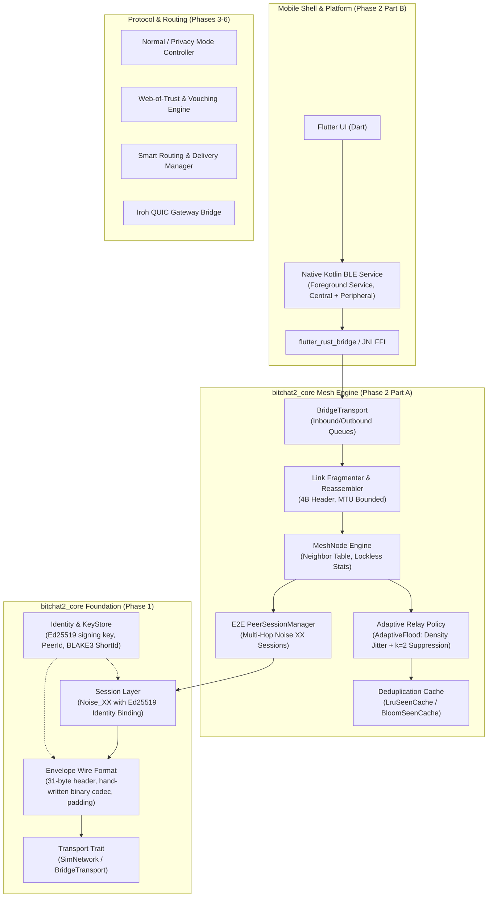

# Bitchat 2.0 Architecture

## 1. System Overview

Bitchat 2.0 is a decentralized peer-to-peer and mesh messaging platform designed to operate under zero-connectivity constraints as well as hybrid mesh-internet topologies:
- **Local Mesh**: Nearby devices communicate via peer-to-peer Bluetooth Low Energy (BLE) mesh links, propagating messages hop-by-hop up to 7 hops without internet access.
- **Internet Bridging**: Nodes with internet connectivity act as transparent gateways, tunneling messages via Iroh (dial-by-public-key over QUIC) to remote gateways that rebroadcast into distant meshes.
- **Identity & Security**: Cryptographic Ed25519 keys replace phone numbers and centralized directories; sessions provide forward secrecy via Noise_XX with explicit Ed25519 static-key binding.

---

## 2. Layered Architecture

### Module Responsibilities

1. **`core::identity`**:
   - Manages cryptographic long-term identity via Ed25519 keypairs.
   - Computes canonical `PeerId` (32-byte public key) and `ShortId` (first 8 bytes of `blake3(public_key)`).
   - Enforces memory zeroization (`zeroize`) and redacted `Debug` representations.
   - Defines abstract `KeyStore` trait with `MemoryKeyStore` and development `FileKeyStore`.

2. **`core::envelope`**:
   - Formats and parses byte-exact, compact 31-byte binary headers without serialization frameworks.
   - Tracks packet lineage via immutable `msg_id` (`blake3(sender_pubkey || counter || blake3(payload))`).
   - Supports relay-mutable `hop_count` with maximum TTL of 7 hops.
   - Reversible length-prefixed size bucketing (`pad_to_bucket`) for metadata analysis protection.
   - Excludes relay-mutable `hop_count` from authentication bytes (`auth_bytes`).

3. **`core::crypto`**:
   - Negotiates mutual authentication and forward-secret session keys via `Noise_XX_25519_ChaChaPoly_BLAKE2s`.
   - Strongly binds ephemeral/static Noise keys to long-term Ed25519 identities via signed handshake payloads.
   - Enforces bidirectional ChaCha20-Poly1305 AEAD transport encryption with replay prevention.

4. **`core::transport`**:
   - `Transport` trait defines asynchronous `send`, `broadcast`, `recv`, and `neighbors`.
   - `SimNetwork` provides an in-memory testbed with configurable adjacency topologies, latency simulation, and deterministic seeded packet loss.
   - `BridgeTransport` provides cross-thread FIFO queue bridging connecting the Rust async runtime to foreign environments (Flutter / JNI / Kotlin BLE service).

5. **`core::mesh::fragment`**:
   - Slices envelopes exceeding radio MTU into indexed chunks with a 4-byte header (`frame_id`, `frag_idx`, `total_frags`).
   - `Reassembler` reassembles out-of-order fragments with DoS memory caps (128 concurrent buffers, 4KB payload limit, 10s TTL expiration).

6. **`core::mesh::seen`**:
   - Deduplicates incoming envelopes to avoid infinite broadcast loops and redundant forwarding.
   - `LruSeenCache` provides exact 0% false-positive deduplication with LRU eviction and TTL expiry.
   - `BloomSeenCache` provides high-density memory-bounded 2-rotation Bloom filtering (ADR-0005).

7. **`core::mesh::relay`**:
   - `MeshNode` coordinates packet routing, neighbor tables, fragment reassembly, and lockless atomic telemetry (`MeshStats`).
   - `AdaptiveFlood` mitigates broadcast storms using neighbor-density scaled forwarding delay $[0, D(N)]$ and counter-based duplicate suppression threshold $k=2$ (ADR-0006). Direct unicast neighbors and high-priority packets bypass delays and suppression.

8. **`core::mesh::peer` (`PeerSessionManager`)**:
   - Manages end-to-end multi-hop Noise XX handshakes and encrypted sessions across untrusted intermediary relays.
   - Opaque relaying: Relays inspect only the 31-byte outer envelope header, while intermediate ciphertext remains indecipherable and tamper-proof.

9. **`app/android` & Native Dual-Role BLE GATT (`BitchatBleService.kt`)**:
   - Android Foreground Service maintaining persistent Bluetooth discovery under Doze mode.
   - Dual-role operation: Simultaneously advertises service UUID `0xFD6F` via `BluetoothLeAdvertiser` and scans for mesh peers via `BluetoothLeScanner`.
   - GATT Server and GATT Client write/notify characteristic `0x2A06` exchanges fragmented wire frames over PlatformChannel.

---

## 3. Inherited Concepts vs. Bitchat 2.0 Additions

| Concept / Mechanism | Origin / Inherited | Bitchat 2.0 Addition | Rationale |
|---|---|---|---|
| **Identity Model** | Inherited (Cryptographic keypair) | None (Ed25519 used directly) | Eliminates user registration, phone numbers, and central servers. |
| **Noise Protocol** | Inherited (`Noise_XX_25519_ChaChaPoly_BLAKE2s`) | **Identity-Bound Static Key Signing** | Standard Noise XX does not verify that a static key belongs to a specific long-term identity. Bitchat 2.0 requires Ed25519 signatures in the handshake payload. |
| **Mesh Propagation** | Inherited (Controlled flooding with 7-hop cap) | Planned adaptive backoff and deduplication | 7-hop TTL bounds broadcast storms while covering typical local clusters. |
| **Relay-Mutable Header** | Inherited (Hop counting in headers) | **MAC/Signature Exemption Rule (ADR-0002)** | Relays increment hop count without invalidating end-to-end payload authenticity or cryptographic signatures. |
| **Transport Model** | Single radio in reference apps | **Multi-Transport Smart Routing (BLE + Iroh QUIC)** | Transparently switches between short-range BLE mesh and global Iroh peer-to-peer gateways. |
| **Trust Evaluation** | Primitive or absent | **Web-of-Trust & Device-Class Relaying** | Distinguishes trusted peers, suppresses malicious flooders, and protects battery on constrained nodes. |
| **Metadata Protection** | Best-effort / unpadded | **Reversible Size Bucketing & Cover Traffic** | Obscures message size distributions to resist passive traffic analysis. |
